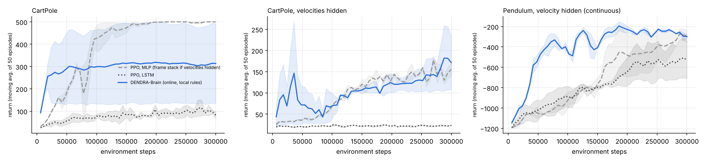
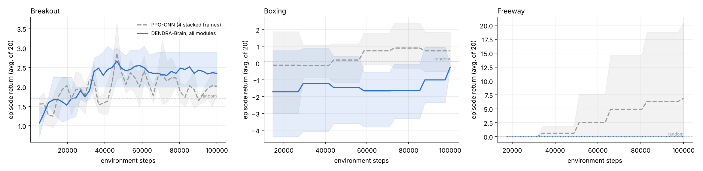
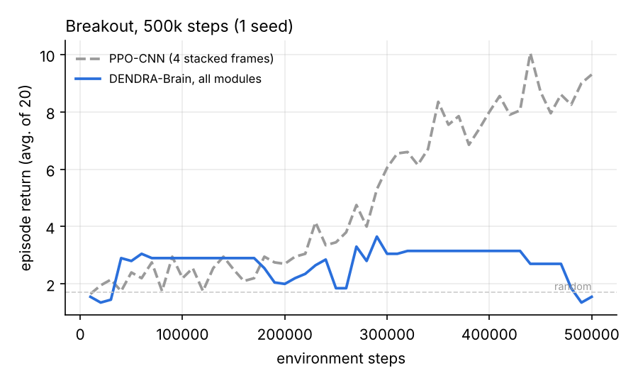

# DENDRA-Brain: reinforcement learning with brain mechanisms, online and without backpropagation

**Abstract.** DENDRA-Brain is a new agent design for reinforcement learning. It is built from mechanisms found in the brain and learns online, after every step, with local rules only: no backpropagation, no replay buffer, no PPO.
- **Senses:** inputs are normalized by sensory adaptation.
- **Memory:** a temporal context of leaky traces ("time cells") makes hidden velocities visible.
- **Cortex:** many small cortical columns turn the input into a sparse place-cell code, recruiting new cells for new situations.
- **Action:** a striatum of action channels learns action values from a dopamine prediction error. Synaptic eligibility tags carry that error back to earlier steps, and the same channels serve discrete actions and continuous motor commands.

We compare it with PPO, using an MLP (with frame stacking when velocities are hidden) and an LSTM, on six control tasks: CartPole, Acrobot, MountainCar and Pendulum, three of them with velocities hidden. Each agent gets 100k environment steps and 3 held-out seeds.
- **At 100k steps:** DENDRA-Brain has the best final score on 5 of 6 tasks. It is the only agent that solves MountainCar at all, and it has the highest area under the learning curve on all six (on Pendulum only slightly above the LSTM).
- **At 300k steps:** PPO-MLP catches up or overtakes. DENDRA-Brain's advantage is speed of learning, not final performance.
- **Weaknesses:** high variance between seeds, some degradation late in training, and so far only low-dimensional sensors (no vision).

**Part II** adds a visual cortex, hippocampal long-term memory and planning, and tests the agent on Atari. There it does **not** learn: it stays near random play and below PPO-CNN once PPO has enough data. Section 9 explains why.

---

## 1. Why a new design

The previous experiments gave two clear lessons:
1. **Backpropagation-free learning fails when memory has to be learned** (section 4.10 of the [README](README.md)). A dopamine rule can train a network on the present, but it cannot assign credit to what the network should have *stored* several steps earlier.
2. **DENDRA + PPO is weak on continuous control** (section 4.9): its HalfCheetah return was half the LSTM's.

DENDRA-Brain changes where the hard problems are solved:
- **Memory needs no training.** A fixed temporal context, leaky traces at several time scales as in hippocampal "time cells", keeps the recent past available. "Input − trace" estimates velocity directly.
- **Representation needs no gradient.** The cortex builds a sparse code by recruiting place cells for new situations. This is unsupervised and local, like the formation of new place fields.
- **The only reward-driven learning is a linear readout from a sparse code to action channels.** For a linear readout, the dopamine × eligibility rule *is* the exact gradient (Sarsa(λ)), so a local rule loses nothing.
- **Continuous actions use the same mechanism as discrete ones.** As in models of the basal ganglia, the striatum selects among motor channels: one group of channels per action dimension, with several command levels each.

## 2. Architecture

```text
observation ─► sensory adaptation ─► temporal context ─► cortical columns ─► striatum ─► action
               (gain control)        (time cells)        (sparse place code)  (action channels)
                                                                                 ▲
reward ─────► dopamine (adaptive coding) ─► δ × eligibility tags ────────────────┘
```

| Module | Brain mechanism | What it computes | How it learns |
| --- | --- | --- | --- |
| Sensory adaptation | gain control in sensory neurons | z-score of every input channel | running mean and variance |
| Temporal context | time cells, Laplace memory of the past | traces at τ = 2 and 8 steps; features: input, input − trace | fixed dynamics, cleared at a new episode |
| Cortical columns | columns with limited receptive fields; place cells; lateral inhibition | 16 areas, each seeing 4 random input channels; one primary area sees the whole observation. In each area at most k = 4 place cells fire, only those whose field contains the input | recruit a cell for an input nothing responds to; recycle the least-used cell when full |
| Striatum | action-value coding in striatal neurons; somatotopic channels | Q(s, channel) = Σ over firing cells of w; one channel group per action dimension (discrete: one channel per action; continuous: 5 command levels) | Sarsa(λ): Δw = η · δ · tag |
| Eligibility tags | synaptic tagging; dopamine acts within a window after activity (Yagishita et al., 2014) | a synapse used in a choice stays tagged, decaying by γλ per step | replacing tags |
| Dopamine | reward prediction error (Schultz; Morris et al., 2006); adaptive coding of reward range (Tobler et al., 2005) | δ = r̃ + γ Q(next) − Q(now), with r̃ = r / running std of the return, clipped to ±10 | — |
| Action choice | basal-ganglia selection; novelty-seeking dopamine (Kakade & Dayan, 2002) | softmax over channels (temperature 0.01) + a bonus for actions rarely tried in the current situation | counts per cell and channel |

**Learning rule** (applied after every step, to every synapse, in every environment):

```math
\delta_t = \tilde r_t + \gamma\, Q(s_{t+1}, a_{t+1}) - Q(s_t, a_t), \qquad
w \leftarrow w + \frac{\eta}{k}\, \delta_t\, e_t, \qquad
e_t = \gamma\lambda\, e_{t-1} \ \text{(then tag the firing cells of the chosen channel)}
```

Defaults: γ = 0.99, λ = 0.9, η = 0.2, 16 columns × 1,024 cells, k = 4, recruitment radius 0.3 and field 2 × radius (in z-score units per channel). The agent runs at about 2,000 environment steps per second on one CPU core.

**Tried and dropped during development:**
- **Motor noise** (node perturbation): learning continuous actions by reinforcing helpful motor noise did not learn Pendulum. It was replaced by motor channels.
- **Novelty bonus in dopamine and reverse hippocampal replay:** removed to keep the design simple, after early single-seed tests showed no clear gain.
- **One large cortical area over all inputs:** fails on 18-dimensional inputs (Acrobot) because almost every state looks new (curse of dimensionality). This is why the cortex is split into many small columns.
- **k-winners-take-all without receptive fields:** a truly new state still activated old cells, so optimism-driven exploration could not work.

## 3. Experiments

**Protocol.**
- **Tasks:** Gymnasium classic control, 8 environments in parallel. "-pomdp" means the velocities are removed from the observation.
- **Budget:** 100k environment steps per run. Score = mean return of the last 50 episodes. AUC = mean of the learning curve over the run.
- **DENDRA-Brain:** settings tuned on seeds 0–1 and evaluated on seeds 10–12.
- **PPO:** the recurrent PPO of `experiments/rl/ppo.py` with standard settings. Learning rate chosen per task and network from {2.5e-4, 1e-3} on seed 10, then evaluated on seeds 10–12.
- **MLP baseline:** sees the last 4 observations when velocities are hidden.
- **Episode ends:** both agents treat episode time limits as terminal.

### 3.1 Results at 100k steps (3 seeds)

| Task | PPO-MLP | PPO-LSTM | **DENDRA-Brain** |
| --- | ---: | ---: | ---: |
| CartPole | 317 ± 28 | 76 ± 15 | **357 ± 159** |
| CartPole, velocities hidden | 38 ± 3 | 23 ± 1 | **91 ± 39** |
| Acrobot | −95 ± 5 | −500 ± 1 | **−90 ± 4** |
| MountainCar (sparse reward) | −200 (never solved) | −200 (never solved) | **−161 ± 23** |
| Pendulum (continuous) | −983 ± 144 | **−500 ± 254** | −603 ± 174 |
| Pendulum, velocity hidden (continuous) | −933 ± 76 | −966 ± 80 | **−521 ± 70** |


- **Faster learning.** DENDRA-Brain has the highest area under the learning curve on all six tasks, though on Pendulum with full observation only slightly above the LSTM. On Acrobot it reaches −100 after about 25k steps; PPO-MLP needs about 60k.
- **Sparse reward:** MountainCar is solved only by DENDRA-Brain. New situations recruit new place cells whose values start at 0, which is optimistic when every step costs −1, so the agent seeks them out. Both PPO agents never reach the goal in 100k steps.
- **Hidden velocities:** the temporal context does the job of a trained recurrent network. DENDRA-Brain beats both the LSTM and the frame-stacked MLP on both partially observed tasks.
- **Continuous control:** motor channels work. On Pendulum with hidden velocity DENDRA-Brain is clearly best; with full observation the LSTM ends higher, but with a large spread.

### 3.2 Longer budget: 300k steps (2 seeds)

| Task | PPO-MLP | PPO-LSTM | DENDRA-Brain |
| --- | ---: | ---: | ---: |
| CartPole | **500 ± 0** | 83 ± 13 | 314 ± 179 (seeds: 492, 135) |
| CartPole, velocities hidden | 156 ± 15 | 24 ± 0 | **172 ± 64** |
| Pendulum, velocity hidden | **−293 ± 59** | −527 ± 185 | −299 ± 22 |



**With 3x more data, PPO-MLP catches up (Pendulum) or overtakes (CartPole).** The main advantage of DENDRA-Brain is sample efficiency. With more data, its final level is limited by instability: one CartPole seed collapses from near 500 to 135.

### 3.3 Ablations: removing one mechanism at a time (100k steps, seeds 10–12)

Final return / mean return over the whole run:

| Variant | CartPole, vel. hidden | Acrobot | MountainCar | Pendulum, vel. hidden |
| --- | ---: | ---: | ---: | ---: |
| Full DENDRA-Brain | 91 / 80 | −90 / −102 | −161 / −161 | −521 / −610 |
| − temporal context | **10 / 14** | −90 / −109 | −133 / −146 | **−1,233 / −1,242** |
| − eligibility traces (λ = 0) | 110 / 98 | **−115 / −168** | −144 / −177 | −384 / −683 |
| − adaptive dopamine coding | **36 / 20** | −84 / −101 | −157 / −160 | −458 / −653 |
| − action-novelty bonus | 112 / 28 | −87 / −101 | −145 / −155 | −469 / −625 |
| − receptive-field gating | 245 / 150 | −88 / −105 | −148 / −154 | −506 / −689 |
| − columns (one area sees everything) | 369 / 161 | **−118 / −173** | −145 / −170 | −519 / −722 |

- **Clearly necessary:**
  - the temporal context, without which tasks with hidden velocities fail;
  - eligibility traces, which speed learning on every task;
  - adaptive dopamine coding;
  - columns, without which Acrobot is much worse.
- **Not clearly helpful:**
  - **Action-novelty bonus:** without it, final scores are similar or better, and learning is slower only on CartPole with hidden velocities.
  - **Receptive-field gating:** removing it gave 245 instead of 91 on CartPole with hidden velocities on these seeds. On the tuning seeds the same change gave 16 instead of 270. This task's result depends strongly on the seed, so it cannot be decided with 3 seeds.

## 4. What this does and does not show

**Shown, on low-dimensional control tasks:**
- An agent with only brain-like local rules, updating after every step, learns several times faster than PPO.
- It handles hidden state with a fixed temporal memory instead of a trained recurrent network.
- It explores sparse-reward tasks through cell recruitment and optimism.
- It uses one mechanism for discrete and continuous actions.

**Not shown (yet), and needed before claiming "better than current RL":**
- **Stronger baselines.** PPO is not the most sample-efficient modern method. DQN/Rainbow (discrete) and SAC (continuous), which use replay buffers, learn these tasks much faster than PPO. They are the real bar for sample efficiency.
- **Stability and final performance.** The variance between seeds is high, and on several tasks performance peaks and then declines (figure in 3.1). Synaptic consolidation (metaplasticity, option `consolidation`) did not fix this.
- **Complex, natural environments.** All tasks here have 2–6 sensor values. Part II tries pixels (Atari) with a visual cortex learned by local Hebbian rules, and fails.
- **What natural environments additionally need:**
  - a world model for planning (hippocampal replay / prefrontal simulation);
  - memory beyond a few seconds;
  - continual learning without forgetting.

## 5. Usage

```python
import gymnasium as gym
from dendra.brain import BrainAgent

N = 8
SAME_STEP = {"autoreset_mode": gym.vector.AutoresetMode.SAME_STEP}   # reset inside the step that ends an episode
envs = gym.make_vec("Acrobot-v1", num_envs=N, vectorization_mode="sync", vector_kwargs=SAME_STEP)
agent = BrainAgent(obs_dim=6, n_actions=3, n_envs=N)                                  # discrete
# envs = gym.make_vec("Pendulum-v1", num_envs=N, vectorization_mode="sync", vector_kwargs=SAME_STEP)
# agent = BrainAgent(obs_dim=3, action_low=[-2.0], action_high=[2.0], n_envs=N)       # continuous

obs, _ = envs.reset(seed=0)
action = agent.reset(obs)
for step in range(10_000):
    obs, reward, terminated, truncated, _ = envs.step(action)
    action = agent.step(obs, reward, terminated | truncated)     # learns from this step, then acts
```

There is no training loop, optimizer or buffer: `agent.step` both learns and acts.

## 6. Reproducing

```bash
# DENDRA-Brain, one run (about 50 s on one CPU core)
python experiments/rl/run_brain.py --env Acrobot-v1 --steps 100000 --seed 10 --out runs/brain/brain_Acrobot-v1_s10.json
# Any setting can be changed, e.g. an ablation:
python experiments/rl/run_brain.py --env CartPole-v1-pomdp --seed 10 --set timescales=none --out runs/abl/x.json

# PPO baselines on the same tasks
python experiments/rl/ppo.py --env classic:Acrobot-v1 --core mlp --total 100000 --lr 2.5e-4 --seed 10 --device cpu --out runs/brain/ppo_Acrobot_s10.json

# Tables and figures
python experiments/rl/plot_brain.py experiments/results/brain/main_100k figures/brain_vs_ppo.png
python experiments/rl/plot_brain.py experiments/results/brain/long_300k figures/brain_vs_ppo_300k.png
python experiments/rl/brain_ablations.py
```

Code: `dendra/brain.py` (the agent), `experiments/rl/run_brain.py`, `experiments/rl/envs.py` (tasks shared with PPO), `experiments/rl/plot_brain.py`, `experiments/rl/brain_ablations.py`. Results: `experiments/results/brain/`.

## References

- Benna, M. K., Fusi, S. *Computational principles of synaptic memory consolidation.* Nature Neuroscience 19, 2016.
- Foster, D. J., Wilson, M. A. *Reverse replay of behavioural sequences in hippocampal place cells during the awake state.* Nature 440, 2006.
- Howard, M. W. et al. *A unified mathematical framework for coding time, space, and sequences in the hippocampal region.* Journal of Neuroscience 34, 2014.
- Kakade, S., Dayan, P. *Dopamine: generalization and bonuses.* Neural Networks 15, 2002.
- Morris, G., Nevet, A., Arkadir, D., Vaadia, E., Bergman, H. *Midbrain dopamine neurons encode decisions for future action.* Nature Neuroscience 9, 2006.
- Schultz, W., Dayan, P., Montague, P. R. *A neural substrate of prediction and reward.* Science 275, 1997.
- Sutton, R. S. *Generalization in reinforcement learning: successful examples using sparse coarse coding.* NeurIPS 1996.
- Tobler, P. N., Fiorillo, C. D., Schultz, W. *Adaptive coding of reward value by dopamine neurons.* Science 307, 2005.
- Yagishita, S. et al. *A critical time window for dopamine actions on the structural plasticity of dendritic spines.* Science 345, 2014.

---

# Part II. Vision, long-term memory and planning: Atari

**Goal.** Extend DENDRA-Brain to learn from raw pixels, still online and with local rules only, by adding three systems:
1. a multi-layer visual cortex that learns its own features without reward;
2. a hippocampal long-term (episodic) memory;
3. a world model used for planning.

Test it on real Atari games.

**Result in short: it does not work yet.**
- At 100k steps, both DENDRA-Brain and PPO-CNN stay near random play on Breakout, Boxing and Freeway.
- With 5x more data (Breakout, 500k steps), PPO starts to learn (9.3) and DENDRA-Brain does not (1.6).
- Published sample-efficient deep-RL methods reach 13–38 on these games at 100k steps.

The sections below describe the design, the numbers, and the most likely reason for the failure.

## 7. Architecture (`dendra/vision.py`, `dendra/visual_brain.py`)

```text
frame ─► retina ─► V1 ─► V1 complex ─► V2 ─► V2 complex ─┬─► dendritic conjunctions ─┐
         (light +   (simple  (2x2 pool)  (3x3   (2x2 pool)  │   (pairs of moving        ├─► striatum Q(s,a) ─┐
          motion)    cells)               of V1)            │    features, by relative  │   Sarsa(λ), tags   │
                                                            │    position)             ─┘                    ├─► action
                                                            ├─► hippocampus: episodic memory of returns ─────┤
                                                            │      (kNN recall = pattern completion)         │
                                                            └─► hippocampal map of transitions ─► planning by prioritized replay ─► striatum
```

| System | Brain mechanism | Implementation | Learning |
| --- | --- | --- | --- |
| Retina | luminance and transient (motion) cells | 84×84 grayscale + difference to the previous frame | none |
| V1 | simple cells, lateral inhibition | 64 cell types on 8×8 patches (stride 4); per location only the best-matching cell fires, if the patch has contrast | competitive Hebbian rule with a homeostatic "conscience"; **critical period**: plasticity fades to 0 over the first 3,000 steps |
| V1 complex, V2, V2 complex | complex cells (position tolerance); V2 conjunctions | 2×2 max-pool; 128 V2 types on 3×3 arrangements of V1 features; 2×2 max-pool | same rule |
| Habituation | sensory adaptation | features that are almost always on (walls, bricks) stop driving the conjunctions | running average |
| Dendritic conjunctions | coincidence detection on dendritic branches | pairs of non-habituated V1 features coded by (type, type, relative offset), e.g. "ball two cells left of paddle"; the idea follows Blob-PROST features (Liang et al., 2016) | none (fixed) |
| Striatum | dopamine-gated corticostriatal plasticity | linear Q over about 200–400 active features | Sarsa(λ) with **replacing** eligibility tags kept for 10 steps; adaptive dopamine coding |
| Hippocampus: long-term memory | episodic memory, pattern completion | per action, up to 20k memories (random-projection key → discounted return); recall = the k = 7 most similar | write at the end of each episode, keeping the best return per key (episodic control; Blundell et al., 2016) |
| Hippocampus: world model and planning | replay prioritized by expected benefit (Mattar & Daw, 2018) | memory of experienced transitions; each step replays 4 transitions per environment, chosen in proportion to surprise \|δ\| | Q-learning backup with a bounded δ |

There is no backpropagation anywhere. The one non-biological shortcut is weight sharing: the same V1/V2 cell types at every location stand for many columns of the same type.

**Problems found and fixed during development:**
- **The visual code drifted.** Cells kept changing what they responded to, so the striatum's weights lost their meaning. Fixed by a critical period, and by letting the homeostatic bias choose only which cell *learns*, not which one *fires*.
- **The eligibility tags were unstable.** Consecutive frames share most features, so accumulating tags moved each value about 5x per step and the weights diverged to NaN. Fixed by replacing tags (a synapse holds only its most recent tag).
- **Planning diverged.** Replayed `max` backups with function approximation are the classic "deadly triad". Fixed by a smaller replay learning rate and a bounded replayed δ.

## 8. Experiments on Atari

**Protocol.**
- **Environments:** ALE v5 (sticky actions), 84×84 grayscale, frame skip 4, 8 environments in parallel.
- **Budget:** 100k environment steps (the "Atari 100k" budget).
- **Score:** mean return of the last 20 training episodes. Seeds 10–12; development used seed 0 only.
- **DENDRA-Brain:** all modules on, as decided before the runs.
- **PPO-CNN:** the standard Atari network with 4 stacked frames and standard hyperparameters.
- **Hardware:** both on one CPU core.

| Game | Random | PPO-CNN | **DENDRA-Brain** | Published at 100k: SPR / Rainbow (enh.) | Human |
| --- | ---: | ---: | ---: | ---: | ---: |
| Breakout | 1.7 | 2.0 ± 0.3 | 2.4 ± 0.4 | 13 / 14 | 30.5 |
| Boxing | 0.1 | 0.7 ± 1.0 | −0.3 ± 0.1 | 38 / 28 | 12.1 |
| Freeway | 0.0 | 6.9 ± 9.6 (seeds: 20.4, 0.2, 0.0) | 0.0 ± 0.0 | 21 / 6 | 29.6 |

Sources for the reference rows:
- **Random and human scores:** the Atari-5 paper (Aitchison et al., 2022).
- **SPR and Rainbow (enhanced):** the Atari-100k table in arXiv:2606.21297.

These published methods use deep networks trained by backpropagation, replay with many updates per step, and GPUs. They are also evaluated with separate test episodes, so their numbers are only a rough yardstick.



**Longer run, Breakout, 500k steps (1 seed):** PPO-CNN **9.3**, DENDRA-Brain **1.6**. PPO starts to learn at about 300k steps; DENDRA-Brain shows no learning trend.



**Ablations.** These were planned (removing planning, hippocampal memory or conjunctions) but stopped after one game and one seed. With the full agent at random level they could not tell anything (Breakout, seed 10: without planning 0.9, without memory 1.25, without conjunctions 2.2, full agent 2.0; a single seed at this noise level does not separate them). The compute went to the 500k-step run instead.

**Speed:** DENDRA-Brain runs at 260–340 steps/s on one CPU core, versus about 200 for PPO-CNN.

## 9. Why it fails, and what that teaches

1. **Representation without credit.**
   - On the low-dimensional tasks of Part I, a code built without reward was enough, because the right variables (angles, velocities) were already the inputs.
   - From pixels, the relevant variables (where the ball is relative to the paddle, whether the ball is in play) are a tiny part of what V1/V2 encode. A linear readout over a few hundred unsupervised features has to find them by trial and error.
   - PPO's CNN learns *task-relevant* features because the reward signal reaches the visual layers through backpropagation. **Local rules alone gave the visual cortex no signal about what matters.**
   - The brain is thought to solve this with signals that do reach sensory cortex: attention and top-down feedback, dopamine and acetylcholine acting on cortical plasticity, and prediction errors (predictive coding). None of these is in this version.
2. **A concrete failure symptom.** In the 500k run, DENDRA-Brain's episodes were about 4.6x longer than PPO's (373 versus 1,733 episodes in the same number of steps). After losing a life it often does not press FIRE, so the ball stays out of play. Linking "no ball" to "FIRE pays off later" needs credit over long delays, and the 10-step tags do not reach that far.
3. **Exploration.** Freeway needs the chicken to keep moving up for about 2,000 steps before any reward. A softmax over noisy values never gets there. One PPO seed found it (20.4); DENDRA-Brain never did. The action-novelty bonus of Part I is not in the visual agent, and count-based novelty over a high-dimensional visual code is an open design question.
4. **Planning and memory cannot help without a good code.** Episodic memory and replay propagate value efficiently *along the features they are given*. With a code that does not separate the situations that matter, they mostly add noise.

**Next steps suggested by this result:**
- **Learn visual features from prediction:** cortex trained, still locally, to predict the next frame and the reward (predictive coding, a world model in feature space). This is how sample-efficient deep-RL methods such as SPR and DreamerV3 shape their features.
- **Top-down, dopamine-gated plasticity in V2:** features that carry reward information become more stable or more numerous.
- **Credit over longer delays:** longer eligibility tags for the striatum, and slower time cells in the visual context.
- **Novelty-driven exploration in visual space.**

## 10. Reproducing Part II

```bash
python experiments/rl/run_visual_brain.py --game Breakout --steps 100000 --seed 10 --set episodic=1.0 planning=4 --out runs/atari/full_Breakout_s10.json
python experiments/rl/ppo.py --env atari:Breakout --core mlp --total 100000 --seed 10 --device cpu --out runs/atari/ppo_Breakout_s10.json
python experiments/rl/plot_atari.py experiments/results/brain_atari/main_100k figures/brain_atari.png
```

Additional references (Part II):
- Aitchison, M., Sweetser, P., Hutter, M. *Atari-5: Distilling the Arcade Learning Environment down to five games.* arXiv:2210.02019, 2022.
- Blundell, C. et al. *Model-free episodic control.* arXiv:1606.04460, 2016.
- Liang, Y., Machado, M. C., Talvitie, E., Bowling, M. *State of the art control of Atari games using shallow reinforcement learning.* AAMAS 2016.
- Mattar, M. G., Daw, N. D. *Prioritized memory access explains planning and hippocampal replay.* Nature Neuroscience 21, 2018.
- Schwarzer, M. et al. *Data-efficient reinforcement learning with self-predictive representations (SPR).* ICLR 2021.
