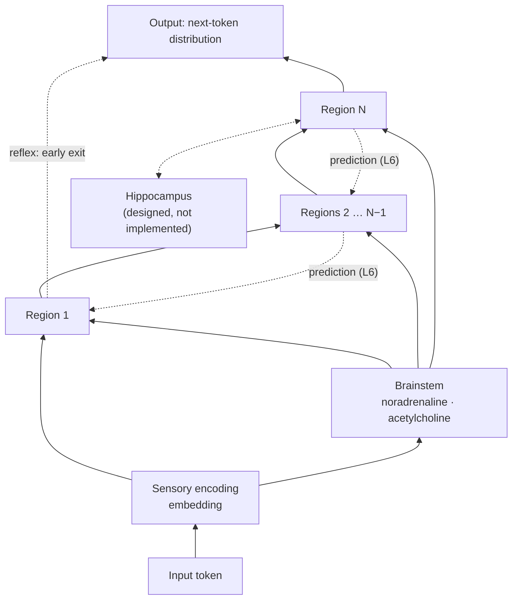
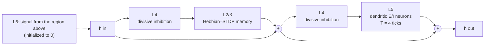
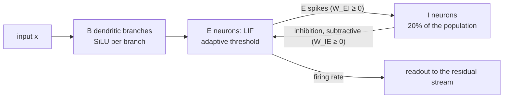
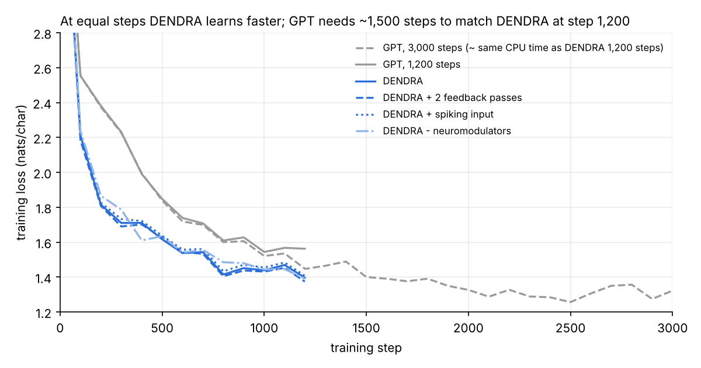
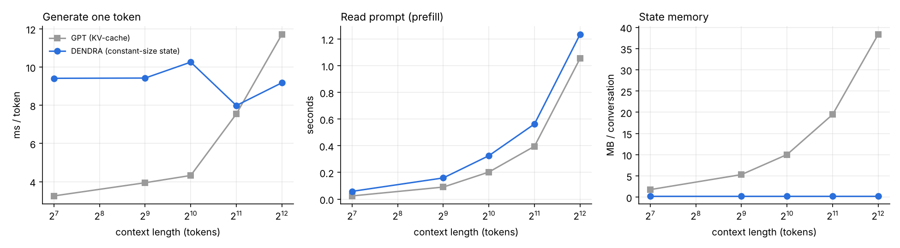
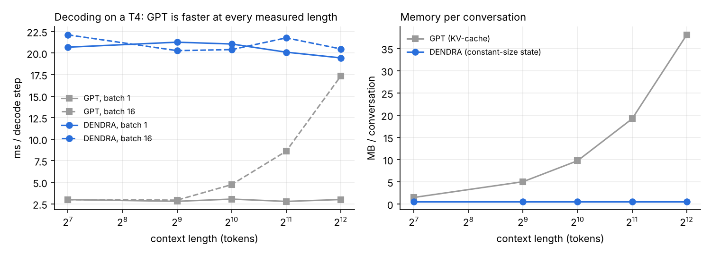
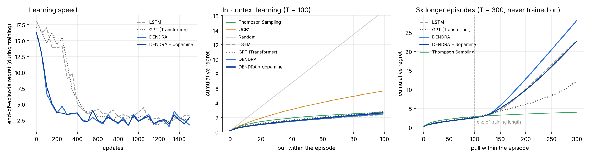
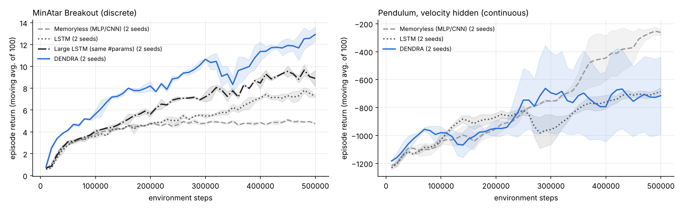

# DENDRA: a language model built from the mechanisms of biological neurons

**DENDRA** = **DEN**dritic, **D**ale-constrained, **R**ecurrent **A**ssociative memory.

> **Abstract.** DENDRA is an autoregressive language model in which every component of the Transformer is replaced by a mechanism found in the brain:
> - spiking LIF neurons with several nonlinear dendritic branches replace the activation function;
> - excitatory/inhibitory (E/I) microcircuits obeying Dale's law replace normalization;
> - a Hebbian synaptic memory with a causal STDP window replaces self-attention;
> - neuromodulators (noradrenaline, acetylcholine) adjust sensitivity and memory writing to the context;
> - top-down feedback connections and a "reflex" path allow early exit.
>
> The model trains with backpropagation and surrogate gradients and runs in three modes that give identical outputs: parallel for training, chunked for reading a prompt, and recurrent with a constant-size memory for generation.
>
> On Tiny Shakespeare (character level, about 1M parameters), at an equal 1,200 training steps DENDRA reaches **2.36 bits/char** versus **2.51** for a same-size GPT. GPT is better at equal training time (2.21). During generation DENDRA needs only a constant-size state (0.29–0.59 MB) per conversation at any context length, while GPT needs 38 MB at 4,096 tokens. On CPU, DENDRA decodes each token faster than GPT beyond about 2,000–4,000 tokens. On a T4 GPU it does not yet: its decode time is almost constant (about 20 ms/step) but still slower than GPT at every measured length, because it is bound by the number of kernel launches.
>
> At 16M parameters on Vietnamese TinyStories (BPE tokenizer), both models tell coherent stories, but GPT reaches a lower perplexity after the same 4,000 steps: 6.8 versus 7.6. With CUDA Graphs and `torch.compile`, DENDRA generates text 4–6x faster and trains 1.6x faster than the naive implementation.
>
> In reinforcement learning (meta-RL on bandits), DENDRA learns an exploration strategy on par with Thompson Sampling and needs 2–3x less experience than LSTM/GPT, but generalizes worst when episodes are longer than in training. With PPO on an Atari-style game (MinAtar Breakout, discrete actions), DENDRA scores 12.9 versus 8.9 for a parameter-matched LSTM. With continuous actions (Pendulum with hidden velocity), it does not yet beat simple networks.

---

## Contents

1. [Introduction](#1-introduction)
2. [From biology to the model](#2-from-biology-to-the-model)
3. [The DENDRA architecture](#3-the-dendra-architecture)
4. [Experiments](#4-experiments)
5. [Discussion](#5-discussion)
6. [Related work](#6-related-work)
7. [Future work](#7-future-work)
8. [Reproducing the results](#8-reproducing-the-results)
9. [Project structure](#9-project-structure)
10. [About the name](#10-about-the-name)
11. [References](#11-references)

---

## 1. Introduction

Transformers process language extremely well, but they differ from the brain in three big ways:

1. **Every neuron is active** at every step. In the brain most neurons are silent and fire only when needed.
2. **Short-term memory is a list of every past token** (the KV cache), which grows with the context. The brain does not store text verbatim; it changes synaptic strengths.
3. **There is no global signal** that changes the network's "mode". In the brain, neuromodulators (dopamine, noradrenaline, ...) do this.

DENDRA asks: *if we build an LLM only from mechanisms that exist in the cortex, can it learn language, and what do we gain?*

Three design principles:

- **Borrow a mechanism only when it has a clear computational benefit.** The model does not simulate ions or chemistry.
- **Every component must be differentiable** so the model trains with backprop on GPUs. Local learning rules (Hebb, STDP) drive the fast weights at run time; they do not replace backprop.
- **Every component must run and be measured.** Every claim in this document comes with a measured number.

## 2. From biology to the model

| Biological mechanism | Component in DENDRA | Engineering benefit |
| --- | --- | --- |
| ~-55 mV threshold, all-or-none spikes | LIF neurons emitting 0/1 spikes | Multiply -> add when inputs are spikes |
| 1–2 ms refractory period | Threshold rises after each spike, soft reset | Prevents "spike storms" |
| Rate coding | Each token runs for T = 4 gamma ticks | Naturally quantized values (5 levels) |
| Nonlinear dendritic computation | B = 4 branches, each with its own nonlinearity | One neuron ≈ a 2-layer network |
| Glutamate (excitation) / GABA (inhibition) | E (80%) and I (20%) populations, Dale's law | Replaces LayerNorm, stable dynamics |
| Hebb's rule | Fast-weight memory `S ← λS + w·v kᵀ` | Replaces attention, constant-size memory |
| NMDA coincidence detection | Write gate `w_t` | Selective memory writing |
| STDP: pre-before-post strengthens | Causal decaying window `λ^(i−j)`, `j ≤ i` | Masks the future, no position embedding needed |
| Noradrenaline: arousal | Global gain on neuron input currents | Context-dependent sensitivity |
| Acetylcholine: opens the gate for learning | Write-rate gate of the Hebbian memory | Choose to remember or ignore |
| 6-layer cortex | Each block split into L4 / L2/3 / L5 / L6 | Clear roles |
| Feedback connections, predictive coding | Higher regions send signals down (L6), several passes | Refined representations |
| Spinal reflex | Early-exit head after region 1 | Easy tokens cost less compute |
| Na⁺/K⁺ pump, the brain uses 20% of the body's energy | Homeostasis loss keeping the firing rate ≈ 15% | Sparse, efficient |

## 3. The DENDRA architecture

### 3.1. Overview

Each token travels upward through N identical **cortical regions**. Higher regions send predictions back down in the next pass. A "brainstem" broadcasts neuromodulators to every region. Easy tokens can take the reflex path from region 1 straight to the output.



### 3.2. One cortical region

Each region is a residual block divided like the layers of the cortex:

| Layer | Role in the brain | In DENDRA |
| --- | --- | --- |
| L4 | Receives input from lower areas | Divisive inhibition (`DivisiveNorm`) on the residual stream |
| L2/3 | Lateral connections, projects to higher areas | Hebbian–STDP memory: mixes information across tokens |
| L5 | Large pyramidal neurons, main output | Dendritic E/I microcircuit, writes firing rates into the residual stream |
| L6 | Sends and receives feedback | Projects the signal from the region above (previous pass) into this region |



```text
h ← h + L6(h_region_above)                    (from the 2nd pass on)
h ← h + HebbianSTDP(DivisiveNorm(h))          (L2/3: mixing over time)
h ← h + DendriticSpikingE/I(DivisiveNorm(h))  (L5: per-token computation)
```

The residual stream carries continuous values. It plays the role of *electrical synapses*: fast and stable for gradients, but less flexible than chemical synapses.

### 3.3. Dendritic LIF neurons (L5)

Each excitatory neuron has B = 4 dendritic branches. Each branch receives its own input and passes it through a local nonlinearity (a "dendritic spike") before summing at the soma:

$$c_b = W_b\,x,\qquad I = g_{NE}\sum_{b=1}^{B} a_b\,\mathrm{SiLU}(c_b),\qquad a_b \ge 0$$

The soma integrates over T = 4 gamma ticks per token, with a leaky potential, inhibition from the I population and an adaptive threshold:

$$u_t = \beta\,u_{t-1} + I - W_{IE}\,s^{I}_{t-1},\qquad s_t = H\!\left(u_t - \theta - \alpha_t\right)$$

$$u_t \leftarrow u_t - \theta\,s_t,\qquad \alpha_t = \rho\,\alpha_{t-1} + \gamma\,s_t,\qquad r = \tfrac{1}{T}\textstyle\sum_t s_t$$

Where:
- `H` is the step function: a spike is always 1; stronger input only produces *more* spikes.
- `β` is the leak, learned per neuron.
- `α` is the refractory period: after each spike the threshold rises by γ = 0.5 and then halves every tick (ρ = 0.5).
- The soft reset (subtract θ) keeps the residual charge.
- The output is the firing rate `r ∈ {0, ¼, ½, ¾, 1}`.

During backpropagation the derivative of `H` is replaced by the surrogate gradient `1/(1 + 2|x|)²`.

### 3.4. Excitatory/inhibitory microcircuit with Dale's law



- The E→I and I→E weights are forced positive with softplus. I neurons can only *subtract* from E neurons: this is Dale's law.
- The E neurons with the strongest input fire first and, through the I neurons, suppress weaker ones on the next tick. The result is a **soft k-WTA** (k-winners-take-all) that emerges from the dynamics rather than from a hard top-k.
- I neurons are 20% of the population (`n_I = n_E / 4`), the proportion found in the cortex.
- The readout from E neurons into the residual stream has no sign constraint. This is a deliberate compromise to keep expressiveness.

### 3.5. Hebbian–STDP memory instead of attention (L2/3)

Instead of storing every past token, each head keeps a fast synaptic matrix `S` and updates it with Hebb's rule:

$$S_t = \lambda_h\,S_{t-1} + w_t\,v_t k_t^{\top},\qquad o_t = S_t\,q_t,\qquad w_t = \sigma(W_{\mathrm{NMDA}}\,x_t)\cdot \mathrm{ACh}_t$$

Written for the whole sequence, this becomes:

$$o_i = \sum_{j\le i} \lambda_h^{\,i-j}\; w_j\,(q_i\cdot k_j)\; v_j$$

- **Hebb:** the outer product `v·kᵀ` strengthens the synapse between the presynaptic (`k`) and postsynaptic (`v`) signals.
- **STDP:** the factor `λ^(i−j)` exists only for `j ≤ i` and decays with distance. It is a causal STDP window: it masks the future and encodes relative position, so no position embedding is needed.
- **Multiple time scales:** heads are initialized with time constants of 4, 16, 64 and 256 tokens, and these are learned.
- **NMDA:** the gate `w_t` decides whether a token is written into the synapses. The output gate `SiLU(G·x)` plays the role of a depolarized postsynaptic neuron.

Mathematically this is *linear attention with decay* (the same family as RetNet, GLA and Mamba2). Schlag et al. [4] showed that linear attention is equivalent to "fast weights". DENDRA goes the other way: it starts from Hebb's rule and STDP and arrives at exactly this efficient form of computation.

### 3.6. Neuromodulators

A small "brainstem" module computes a baseline level of the context, a causal moving average of the embeddings, and emits a signal for each region:

$$m_t = \mathrm{EMA}_{0.9}(x_{\le t}),\qquad [\,g_{NE},\ \mathrm{ACh}\,] = 2\,\sigma(W m_t)$$

- **Noradrenaline (`g_NE`):** multiplies the input current of every L5 neuron, i.e. sets the sensitivity of the region.
- **Acetylcholine (`ACh`):** multiplies the write gate of each head, i.e. sets how much is remembered.
- `W` is initialized to 0, so all signals start at 1 and the model learns when to adjust them.
- **Dopamine** (reward prediction error, used for RL fine-tuning) and **serotonin** (patience, number of thinking passes) are part of the design but not implemented in the language model; a dopamine gate is tested in section 4.8.

### 3.7. Top-down feedback and the reflex path

- **Feedback (L6):** with `fb_cycles = 2`, the first pass goes bottom-up as usual. In the second pass each region adds a projection of the output of the region directly above it from the first pass. The signal comes from the same token only, so no future information leaks.
- **Reflex:** an auxiliary output head after region 1, trained with loss weight 0.3. At inference, if its top probability exceeds a threshold τ, the model answers immediately without running the higher regions.

### 3.8. Loss function

$$\mathcal{L} = \mathcal{L}_{CE} + 0.3\,\mathcal{L}_{CE}^{\,reflex} + \sum_{l}\big(\bar r_l - r^{*}\big)^2,\qquad r^{*} = 0.15$$

The last term is **homeostasis**: it keeps the mean firing rate of each region near 15%, like the Na⁺/K⁺ pump keeping neurons ready to fire.

### 3.9. Three computation modes

The same weights can run in three ways. The logits of all three match, with errors below 10⁻⁵ (checked in the code):

| Mode | Function | Used for | Cost in length n | State memory |
| --- | --- | --- | --- | --- |
| Parallel | `forward()` | Training | O(n²) per segment | — |
| Chunked | `prefill()` | Reading a prompt | O(n·C), C = 128 | Constant |
| Recurrent | `step_token()` | Generating one token at a time | O(1) per token | **Constant**: h × (d/h)² numbers per region (6 × 64 × 64 in the 16M configuration) |

## 4. Experiments

### 4.1. Setup

- **Data:** Tiny Shakespeare [9], 1.1 MB, character level (65 characters), 90% train / 10% validation.
- **DENDRA:** d = 128, 4 regions, 4 heads, 192 E neurons + 48 I neurons per region, B = 4, T = 4; **0.98M** parameters in total.
- **GPT baseline:** 4 layers, d = 128, 4 heads, 4d MLP; **0.82M** parameters in total.
- **Training:** context 128, batch 32, AdamW (lr 2·10⁻³, cosine), CPU.
- **Evaluation:** 40 fixed validation batches, measured in bits per character (lower is better).
- Each configuration ran **once (seed 0)**, so differences below ~0.03 bits/char may be noise.

### 4.2. Main results

| Model | Params | Steps | Bits/char ↓ | Next-char accuracy |
| --- | --- | --- | --- | --- |
| GPT | 0.82M | 1,200 | 2.51 | 48.3% |
| GPT, ≈ same CPU time as DENDRA | 0.82M | 3,000 | **2.21** | **54.4%** |
| **DENDRA** | 0.98M | 1,200 | 2.36 | 51.6% |
| DENDRA − neuromodulators | 0.98M | 1,200 | 2.39 | 51.1% |
| DENDRA + 2 feedback passes | 0.98M | 1,200 | 2.34 | 51.9% |
| DENDRA + spike-encoded dendritic input | 0.98M | 1,200 | 2.40 | 50.8% |



**Observations:**
- **At equal steps, DENDRA is clearly better** (2.36 vs 2.51). The decaying memory gives the model a locality bias that helps at the character level.
- **At equal time, GPT is better** (2.21). Each DENDRA step is about 2.5x slower on CPU because of the T-tick loop.
- **Neuromodulators** help by 0.03 bits/char and **feedback** by 0.02 (at twice the compute). Both are close to the noise level and need more seeds to be conclusive.
- **Spike-encoded input** (ON/OFF coding of the dendritic input) costs 0.04 bits/char; in exchange, 68% of operations become additions (section 4.4).

### 4.3. Behaviour inside the model

- **Sparsity:** the homeostasis loss keeps the E firing rate at 15–16% in all 4 regions. I neurons fire on 36–48% of ticks, more than E neurons, like fast-spiking interneurons in the cortex.
- **Synapses choose shorter memories:** time constants are initialized at 4/16/64/256 tokens and end up around 2/7/25/100 after training, which is reasonable for character-level data.
- **Reflex path:**

| Threshold τ | Tokens exiting at region 1 | Accuracy of exited tokens | Overall accuracy (no exit: 51.6%) |
| --- | --- | --- | --- |
| 0.9 | 6% | 96% | 51.6% |
| 0.7 | 21% | 84% | 51.4% |
| 0.5 | 37% | 72% | 50.3% |

At τ = 0.7, 21% of tokens skip 3 of the 4 regions while overall accuracy drops by only 0.2 points.

### 4.4. Energy (theoretical estimate)

Estimated from the cost per operation in a 45 nm process [8]: 4.6 pJ per multiply-accumulate (MAC), 0.9 pJ per accumulate (AC). Accumulates only happen when a spike arrives. **These are not measurements**: the benefit only materializes on neuromorphic hardware.

| Model | Share of operations that are additions | Energy / token, context 64 | Energy / token, context 2,048 |
| --- | --- | --- | --- |
| GPT | 0% | 3.96 µJ | 13.3 µJ |
| DENDRA | 16% | 3.67 µJ | 3.67 µJ |
| DENDRA + spiking input | 68% | 2.46 µJ | 2.46 µJ |

### 4.5. Inference speed on CPU

Measured on a 2-thread CPU with ~16M-parameter models (d = 384, 6 regions/layers), the configuration of the Kaggle notebook. GPT uses a KV cache; DENDRA uses chunked `prefill()` and `step_token()` with a constant-size state.

| Context | Decode 1 token, GPT | Decode 1 token, DENDRA | Read prompt, GPT | Read prompt, DENDRA | Memory, GPT | Memory, DENDRA |
| --- | --- | --- | --- | --- | --- | --- |
| 128 | **3.3 ms** | 9.4 ms | **0.02 s** | 0.06 s | 1.8 MB | **0.29 MB** |
| 1,024 | **4.3 ms** | 10.3 ms | **0.20 s** | 0.33 s | 10 MB | **0.29 MB** |
| 2,048 | 7.5 ms | 8.0 ms | **0.40 s** | 0.56 s | 19 MB | **0.29 MB** |
| 4,096 | 11.7 ms | **9.2 ms** | **1.05 s** | 1.24 s | 38 MB | **0.29 MB** |



At short contexts GPT decodes 2–3x faster. DENDRA stays around 9 ms/token at every length and overtakes GPT somewhere between 2,000 and 4,000 tokens. The biggest advantage is memory: it does not grow with the context, so one GPU can serve many more conversations at once.

### 4.6. On GPU with Vietnamese (Kaggle, T4 × 2)

**Setup:**
- **Data:** 200,000 Vietnamese TinyStories [10], byte-level BPE tokenizer with 8,192 tokens trained on the data.
- **Training:** context 256, batch 32, 4,000 steps.
- **Models:** d = 384, 6 regions/layers, about 16M parameters each.
- **GPU allocation:** DENDRA on GPU 0, GPT on GPU 1, in parallel. Numbers are taken from the notebook output and stored in `experiments/results/kaggle_t4_tinystories_vi.json` and `bench_t4_kaggle.json`.

**Training (4,000 steps per model):**

| Model | Params | Val loss ↓ | Perplexity ↓ | Time per step |
| --- | --- | --- | --- | --- |
| GPT | 13.9M | **1.915** | **6.8** | ~73 ms |
| DENDRA | 16.2M | 2.032 | 7.6 | ~390 ms; ~238 ms with `torch.compile` |

On Vietnamese data with a BPE tokenizer, **GPT is better** at equal steps, the opposite of the character-level result in section 4.2. One hypothesis: each BPE token carries more information than a character, so the "local memory" advantage of a decaying memory matters less and attention's exact look-back matters more. DENDRA predicts the next token correctly 53.0% of the time.

Note on the source of the numbers: the GPT numbers come from run 1. In run 2 (with `torch.compile`), a speed-measurement bug made GPT stop after 1,032 steps, so that run is not used; the bug is fixed in the notebook.

**Inside DENDRA:**
- **E firing rate:** 14.3–14.9% in all 6 regions, on target.
- **Synaptic time constants:** initialized at 4–256 tokens, about 2–111 tokens after training.
- **The two run modes agree:** the logits of the parallel and recurrent modes differ by at most 1.7·10⁻⁵ (fp16).
- **Reflex path:**

| Threshold τ | Tokens exiting at region 1 | Accuracy of exited tokens | Overall accuracy (no exit: 53.1%) |
| --- | --- | --- | --- |
| 0.9 | 10% | 97% | 53.1% |
| 0.7 | 21% | 89% | 52.9% |
| 0.5 | 34% | 78% | 52.3% |

On Vietnamese data the reflex path works better than on Tiny Shakespeare: 10% of tokens exit at region 1 with no loss of accuracy.

**Generated text** (temperature 0.8, top-k 50, opening lines; the models write Vietnamese, English translations in brackets):

> **DENDRA** — *Ngày xửa ngày xưa, có một cô bé tên Lily. Cô bé thích chơi với đồ chơi và sách vở của mình. Một hôm, cô bé tìm thấy một chiếc hộp lớn trong hộp đồ chơi của mình. Cô bé rất thích chiếc hộp đó!*
> [Once upon a time, there was a little girl named Lily. She liked to play with her toys and books. One day, she found a big box in her toy box. She really liked that box!]

> **GPT** — *Một hôm, cô bé muốn chơi với đồ chơi của mình. Cô bé nhìn thấy một con vịt bơi gần đó và hỏi, "Con có thể chơi với bố không?" Con vịt nói, "Được, tôi muốn chơi, nhưng tôi bị lạc."*
> [One day, the little girl wanted to play with her toys. She saw a duck swimming nearby and asked, "Can I play with Dad?" The duck said, "Yes, I want to play, but I am lost."]

Both write grammatical text and keep track of characters across several sentences. Generation speed at batch 1 (including prompt reading and sampling): DENDRA originally reached 43–46 tokens/s; with the CUDA Graph decoder (section 4.7) it reaches **168–277 tokens/s**, 4–6x faster. The plain GPT reaches 230–253 tokens/s.

**Inference speed on a T4** (randomly initialized models with the same configuration, ms per decode step):

| Context | GPT, batch 1 | DENDRA, batch 1 | GPT, batch 16 | DENDRA, batch 16 | GPT memory | DENDRA memory |
| --- | --- | --- | --- | --- | --- | --- |
| 128 | **3.0** | 20.7 | **3.0** | 22.1 | 1.5 MB | **0.59 MB** |
| 1,024 | **3.1** | 21.1 | **4.7** | 20.4 | 9.7 MB | **0.59 MB** |
| 2,048 | **2.8** | 20.1 | **8.6** | 21.8 | 19 MB | **0.59 MB** |
| 4,096 | **3.0** | 19.4 | **17.3** | 20.5 | 38 MB | **0.59 MB** |



**Reading the results:**
- **GPT is faster at every measured length on the GPU.** At batch 1 it is about 7x faster.
- **DENDRA's decode time is almost constant** (about 20 ms) in both context length and batch size: batch 16 costs the same as batch 1. This shows that DENDRA is bound by the *number of kernel launches*, not by the amount of computation. The T-tick loop × E/I microcircuit × 6 regions launches hundreds of small operations per token, so kernel fusion (CUDA Graphs, `torch.compile`, Triton) is the most obvious improvement.
- **At batch 16 the gap closes quickly:** GPT goes from 3.0 to 17.3 ms as the context grows while DENDRA stays at about 20 ms. If the trend continues the curves cross at about 5,000 tokens. This is an extrapolation, not a measurement.
- **Prompt reading:** GPT is much faster thanks to optimized attention kernels (4,096 tokens, batch 16: 0.27 s vs 1.28 s).
- **Memory:** DENDRA keeps 0.59 MB per conversation (state stored in fp32); GPT needs 38 MB at 4,096 tokens, 64x more.

### 4.7. Speed optimization: the fast decoder

The T4 numbers in section 4.6 show that DENDRA is bound by the *number of kernel launches*. `dendra/fast.py` addresses this in three steps:

1. **Static state + CUDA Graph:** the whole decode step is captured once and replayed with a single launch.
2. **Fused projections:** q, k, v, the NMDA gate and the output gate become one matrix multiply; softplus/sigmoid of the parameters are precomputed.
3. **`torch.compile` (optional):** fuses the element-wise chain of the LIF loop.

GPT gets exactly the same treatment (preallocated KV cache, CUDA Graph) for a fair comparison. Both match the original path with errors below 10⁻⁵.

**Measured on a 2-thread CPU** (16M parameters, batch 1, ms per decode step; CUDA Graphs have no effect on CPU):

| Context | DENDRA original | DENDRA fast | DENDRA fast + compile | GPT original | GPT fast | GPT fast + compile |
| --- | --- | --- | --- | --- | --- | --- |
| 512 | 8.9 | 7.7 | **3.8** | 4.1 | **3.8** | 16.1 |
| 4,096 | 9.5 | 6.1 | **3.6** | 17.2 | **10.0** | 117.0 |

On CPU the optimized DENDRA is 2.5x faster than before. It ties GPT at 512 tokens and is 2.8x faster than GPT at 4,096 tokens. `torch.compile` slows GPT down on CPU, so each model is counted in its own best mode.

**Training:** `torch.compile` for the whole training step (on by default in the notebook) makes each step 2x faster on CPU for a small model. The losses match exactly and the gradients differ by less than 10⁻⁶.

**On a T4 GPU (measured):**
- **Generation:** CUDA Graphs take DENDRA from 43–46 to 168–277 tokens/s.
- **Training:** `torch.compile` reduces the time per step from ~390 ms to ~238 ms.

Section 6 of the notebook compares the three modes (original / fast / fast + compile) for both models and prints a "WHICH IS FASTER?" verdict for every context length and batch size. That table will be added here.

### 4.8. Reinforcement learning: meta-RL on bandits

**Task** (after Wang et al., 2018):
- Every episode is a new 2-armed bandit. Each arm's win probability is drawn from U(0, 1) and hidden from the agent.
- The agent pulls 100 times. At each step it only sees its previous action, previous reward and the time step.
- Network weights **do not change** within an episode. To do well, the network must explore, remember and exploit within its own state: Hebbian synapses for DENDRA, memory cells for LSTM, context for GPT.

**Setup:**
- **Training:** A2C (γ = 0.9), 1,500 updates × 64 episodes, 2 seeds per agent, on CPU.
- **Evaluation:** 2,000 fixed episodes, measured by cumulative regret (lower is better).
- **"DENDRA + dopamine":** adds a gate `2σ(w·δ + b)` multiplying the write rate of the Hebbian synapses, where δ = reward just received − expected level (moving average), i.e. a dopamine-like reward prediction error.

| Agent | Params | Regret, T = 100 ↓ | Regret, T = 300 (never trained on) ↓ | Updates to reach regret < 5 | Time per decision (CPU) |
| --- | --- | --- | --- | --- | --- |
| LSTM | 146K | **2.38** ± 0.08 | 22.8 ± 5.7 | 300–450 | **0.33 ms** |
| GPT (Transformer, KV cache) | 166K | 2.77 ± 0.23 | **12.1** ± 4.7 | 450–500 | 0.41 ms |
| DENDRA | 124K | 2.49 ± 0.18 | 28.0 ± 1.0 | **150–200** | 1.51 ms |
| DENDRA + dopamine | 124K | 2.63 ± 0.05 | 22.6 ± 1.7 | **150–200** | 1.43 ms |
| *Thompson Sampling* | — | 2.79 | 4.13 | — | — |
| *UCB1* | — | 5.66 | 10.84 | — | — |
| *Random choice* | — | 16.66 | 50.12 | — | — |



**Observations:**
- **All 4 agents learn to explore in context.** At the trained length they match or beat Thompson Sampling, a strong standard algorithm for this task. The differences between agents (2.4–2.8) are within noise with 2 seeds.
- **DENDRA learns fastest in terms of episodes:** it needs 150–200 updates to get regret below 5, versus 300–450 for LSTM and 450–500 for GPT, i.e. 2–3x less experience. This matches the character-level result in section 4.2: DENDRA is sample-efficient.
- **In CPU time, LSTM is still the fastest**, because each DENDRA step costs more (1.5 ms vs 0.3 ms per decision).
- **When episodes are longer than in training, every agent breaks down.** At T = 300 all four are far behind Thompson Sampling. GPT holds up best because it can look back at every past reward; DENDRA's decaying synaptic memory generalizes worst.
- **The dopamine gate is barely used.** The learned weights are tiny (|w| ≤ 0.06), probably because the reward is already part of the input and flows through acetylcholine. The improvement at T = 300 (28.0 → 22.6) is not conclusive. A proper dopamine test needs a task where the reward is not in the input, or whose structure changes within an episode.

### 4.9. Atari-style reinforcement learning: discrete and continuous actions (PPO)

**Setup:**
- **Algorithm:** recurrent PPO (`experiments/rl/ppo_recurrent.py`), shared by discrete actions (Categorical policy) and continuous actions (Gaussian policy).
- **Cores compared:** DENDRA, LSTM, and a memoryless network that sees the last 4 frames (the standard Atari approach).
- **DENDRA training:** backpropagation runs in parallel over time and clears the state exactly at episode boundaries. This matches step-by-step execution (error below 10⁻⁵) and is 17x faster.
- **Budget:** 500,000 environment steps, 2 seeds per configuration, on CPU.

| Environment | Core | Params | Return (mean of last 100 episodes) ↑ | Steps/s (CPU) |
| --- | --- | --- | --- | --- |
| **MinAtar Breakout** (discrete, 6 actions) | Memoryless | 149K | 4.75 ± 0.05 | 2,825 |
| | LSTM | 265K | 7.27 ± 0.09 | 1,188 |
| | Large LSTM (same #params) | 615K | 8.89 ± 0.72 | 495 |
| | **DENDRA** | 635K | **12.91** ± 0.67 | 758 |
| **Pendulum, velocity hidden** (continuous, 1-D) | **Memoryless, sees 4 frames** | 13K | **−263** ± 21 | 2,278 |
| | LSTM | 104K | −687 ± 31 | 702 |
| | DENDRA | 499K | −716 ± 275 | 441 |



**Observations:**
- **Discrete actions (Breakout):** DENDRA leads clearly and consistently in both seeds, from the very first steps.
    - Against a parameter-matched LSTM, DENDRA scores 45% higher (12.9 vs 8.9) and still runs faster (758 vs 495 steps/s), so the advantage is not just model size.
    - This repeats the finding of sections 4.2 and 4.8: DENDRA is sample-efficient.
- **Continuous actions (Pendulum with hidden velocity):** the memoryless network that sees 4 frames wins by a wide margin.
    - Two consecutive frames are enough to infer the velocity, so this task does not really require long memory.
    - DENDRA and LSTM have not converged after 500,000 steps. DENDRA varies strongly between seeds (−441 and −991): with continuous actions it is less stable.
- **Real Atari (ALE) and MuJoCo:** too heavy for a CPU. The pipeline has been smoke-tested on `atari:Breakout` and `mujoco:HalfCheetah-v5-pomdp`; the notebook `notebooks/DENDRA_RL_kaggle.ipynb` runs both in full on a Kaggle GPU.

## 5. Discussion

**Strengths**
- Constant inference memory; decoding does not slow down with context length.
- Better sample efficiency than a same-size Transformer per training step, at the scales tested (language at character level, meta-RL, PPO with discrete actions).
- Sparse activity (about 15%), with potential for large energy savings on neuromorphic chips.
- Fast weights adapt in context; neuromodulators adjust behaviour to the context.
- The reflex path cuts compute for easy tokens with almost no loss of accuracy.
- Internal quantities (firing rates, synaptic time constants, E/I activity) are measurable and interpretable.

**Limitations**
- **Slower on GPU:** on a T4, training is about 5x slower per step and decoding about 7x slower at batch 1, bound by kernel launches. The model also loses to GPT at equal training time.
- **Weak exact recall:** a constant-size memory struggles to retrieve a distant detail verbatim. This is a general weakness of linear recurrent models.
- **Energy figures are estimates;** not yet measured on real hardware.
- **Backprop is still the main learning engine;** local rules only drive the fast weights.
- **Small scale** (1M and 16M parameters, 1–2 seeds). Conclusions may change at larger scale.
- **The biological analogy is loose:** it is an engineering inspiration, not a scientific model of how the brain processes language.

## 6. Related work

| Work | Key idea | How DENDRA differs |
| --- | --- | --- |
| SpikingBrain [1] | Spiking LLMs, 7B (linear) and 76B (hybrid, MoE), converted from existing models | No E/I, dendrites, neuromodulators or feedback |
| SpikeGPT [2] | First spiking LLM trained with backprop, based on RWKV | Simple neurons, no E/I microcircuit |
| Dragon Hatchling (BDH) [3] | Neuron network with E/I circuits, Hebbian synapses, sparse positive activations | Closest to DENDRA; no dendrites, neuromodulators or reflex path |
| Linear Transformers ≡ Fast Weights [4] | Proves linear attention is equivalent to fast weights | Theoretical basis of L2/3 |
| Gated DeltaNet [5] | Gated linear memory with the delta rule | Path to an LTD extension of L2/3 |
| E-I circuits for deep SNNs [6] | Dale's-law E/I circuits replace normalization | Applied to vision, not LLMs |
| Neuromodulation Gated Transformer [7] | Multiplicative neuromodulation in a Transformer | No spikes, no Hebbian memory |

## 7. Future work

1. **Delta rule (LTD)** for L2/3: `S ← λS(I − w k kᵀ) + w v kᵀ`, overwriting instead of accumulating, following Gated DeltaNet [5].
2. **Hippocampus:** an episodic memory stored every theta cycle, plus a "sleep" phase that distills it into the slow weights for continual learning.
3. **Cortical columns as MoE:** K columns per region; the inhibitory population picks the k winning columns; homeostasis replaces the load-balancing loss.
4. **Dopamine and serotonin:** an RPE that drives both the slow weights (RL) and the fast-weight write gate; an adaptive number of feedback passes.
5. **Fused GPU kernels:** CUDA Graphs and `torch.compile` are done (section 4.7). The next step is a single Triton kernel for the whole E/I microcircuit over T ticks. For an even lighter model (requires retraining): reduce T from 4 to 2, or reduce the number of dendritic branches or E neurons.
6. **Scaling up** to 125M and then 1B parameters, with several seeds, against GPT, Mamba2 and Gated DeltaNet at equal budget.

## 8. Reproducing the results

```bash
pip install -r requirements.txt
mkdir -p data runs
curl -o data/input.txt https://raw.githubusercontent.com/karpathy/char-rnn/master/data/tinyshakespeare/input.txt

# Table 4.2 (CPU, about 10–25 minutes per run)
python experiments/prototype/train.py --model gpt    --steps 1200 --out runs/gpt.json
python experiments/prototype/train.py --model gpt    --steps 3000 --out runs/gpt_long.json
python experiments/prototype/train.py --model dendra --steps 1200 --out runs/dendra_fb1.json
python experiments/prototype/train.py --model dendra --steps 1200 --no_nm    --out runs/dendra_nonm.json
python experiments/prototype/train.py --model dendra --steps 1200 --fb 2     --out runs/dendra_fb2.json
python experiments/prototype/train.py --model dendra --steps 1200 --spike_in --out runs/dendra_spikein.json

# Section 4.4: operation counts and energy estimate
python experiments/prototype/ops.py dendra_fb1 dendra_spikein

# Section 4.5: inference speed (CPU or GPU)
python scripts/bench_inference.py --threads 2

# Redraw the figures from experiments/results/
python scripts/make_figures.py

# Section 4.8: meta-RL bandit (CPU, 4–17 minutes per run)
for m in lstm gpt dendra dendra_da; do for s in 0 1; do
  python experiments/rl/rl_bandit.py --model $m --seed $s --updates 1500 --out runs/rl_${m}_s${s}.json
done; done
python experiments/rl/plot_rl.py runs

# Section 4.9: PPO, discrete and continuous actions (CPU: 3–20 minutes per run)
for env in minatar:breakout pendulum-pomdp; do for core in mlp lstm dendra; do for s in 0 1; do
  python experiments/rl/ppo_recurrent.py --env $env --core $core --seed $s --total 500000 \
         --out runs/ppo_$(echo $env | tr ':' '_')_${core}_s${s}.json
done; done; done
python experiments/rl/plot_ppo.py runs
# Real Atari / MuJoCo (a GPU is recommended): --env atari:Breakout  or  --env mujoco:HalfCheetah-v5-pomdp
```

The environment variable `NT` sets the number of CPU threads (default 1).

**On Kaggle/Colab (GPU):**
- `notebooks/DENDRA_kaggle.ipynb`: language modeling on Vietnamese TinyStories. Choose a GPU, enable Internet and *Run All*. The notebook downloads the data, trains a tokenizer, trains both models (in parallel if 2 GPUs are available), plots the results and benchmarks speed.
- `notebooks/DENDRA_RL_kaggle.ipynb`: reinforcement learning on real Atari (discrete) and MuJoCo (continuous).

**Using the model in code:**

```python
import torch
from dendra import DENDRA

model = DENDRA(vocab=8192, d=384, n_regions=6, n_heads=6, n_e=576)
idx = torch.randint(0, 8192, (1, 100))

logits, reflex_logits = model(idx)            # parallel (training)
last_logits, state = model.prefill(idx)       # read the prompt in chunks
next_tok = last_logits[:, -1].argmax(-1, keepdim=True)
logits, state = model.step_token(next_tok, state)   # generate 1 token, constant memory

# Fast decoder (CUDA Graph on GPU, optional torch.compile)
from dendra import make_decoder
logits, dec = make_decoder(model, idx, use_compile=False)
logits = dec(logits.argmax(-1))                     # each call = one decode step
```

## 9. Project structure

```text
.
├── README.md                     this document
├── requirements.txt
├── dendra/
│   ├── __init__.py
│   ├── model.py                  DENDRA (3 modes) + GPT baseline (with KV cache)
│   └── fast.py                   fast decoder: static state + CUDA Graph (+ torch.compile)
├── experiments/
│   ├── prototype/                exact code used for sections 4.2–4.4
│   │   ├── dendra_proto.py
│   │   ├── train.py              training + evaluation on Tiny Shakespeare
│   │   └── ops.py                operation counts, energy estimate
│   ├── rl/                       meta-RL bandit (4.8) + PPO Atari/MuJoCo (4.9): rl_bandit.py, ppo_recurrent.py, plot_*.py
│   └── results/                  JSON results (CPU and Kaggle T4)
├── scripts/
│   ├── bench_inference.py        inference speed benchmark (section 4.5)
│   └── make_figures.py           draws the README figures
├── notebooks/
│   ├── DENDRA_kaggle.ipynb       language modeling on GPU with Vietnamese data
│   └── DENDRA_RL_kaggle.ipynb    reinforcement learning: Atari (discrete) + MuJoCo (continuous) on GPU
└── figures/                      figures
```

`dendra/model.py` extends `dendra_proto.py`: it adds chunked `prefill()`, `step_token()`, a KV cache for GPT, and a convolutional EMA for the neuromodulators. In training mode both versions are numerically identical. The GPT baseline in the new version uses `scaled_dot_product_attention` instead of `nn.MultiheadAttention`.

## 10. About the name

**DENDRA** stands for **DEN**dritic, **D**ale-constrained, **R**ecurrent **A**ssociative memory, the three ideas that set the model apart:

- **Dendritic:** each neuron computes with several nonlinear dendritic branches (section 3.3).
- **Dale-constrained:** excitatory and inhibitory populations with fixed-sign connections (section 3.4).
- **Recurrent associative memory:** Hebbian–STDP synapses replace attention and keep a constant-size state (section 3.5).

The name also echoes *dendrite*, the branch of a neuron that gathers its inputs.

## 11. References

1. Pan, Y. et al. *SpikingBrain Technical Report: Spiking Brain-inspired Large Models.* arXiv:2509.05276, 2025. <https://arxiv.org/abs/2509.05276>
2. Zhu, R.-J., Zhao, Q., Li, G., Eshraghian, J. K. *SpikeGPT: Generative Pre-trained Language Model with Spiking Neural Networks.* TMLR, 2024. <https://arxiv.org/abs/2302.13939>
3. Kosowski, A. et al. *The Dragon Hatchling: The Missing Link between the Transformer and Models of the Brain.* arXiv:2509.26507, 2025. <https://arxiv.org/abs/2509.26507>
4. Schlag, I., Irie, K., Schmidhuber, J. *Linear Transformers Are Secretly Fast Weight Programmers.* ICML, 2021. <https://arxiv.org/abs/2102.11174>
5. Yang, S., Kautz, J., Hatamizadeh, A. *Gated Delta Networks: Improving Mamba2 with Delta Rule.* ICLR, 2025. <https://arxiv.org/abs/2412.06464>
6. *Training Deep Normalization-Free Spiking Neural Networks with Lateral Inhibition.* arXiv:2509.23253, 2025. <https://arxiv.org/abs/2509.23253>
7. Knowles, K. et al. *Neuromodulation Gated Transformer.* arXiv:2305.03232, 2023. <https://arxiv.org/abs/2305.03232>
8. Horowitz, M. *Computing's Energy Problem (and What We Can Do About It).* ISSCC, 2014.
9. Karpathy, A. *Tiny Shakespeare* (char-rnn). <https://github.com/karpathy/char-rnn>
10. nampdn-ai. *tinystories-vietnamese* (Hugging Face dataset, MIT). <https://huggingface.co/datasets/nampdn-ai/tinystories-vietnamese>
